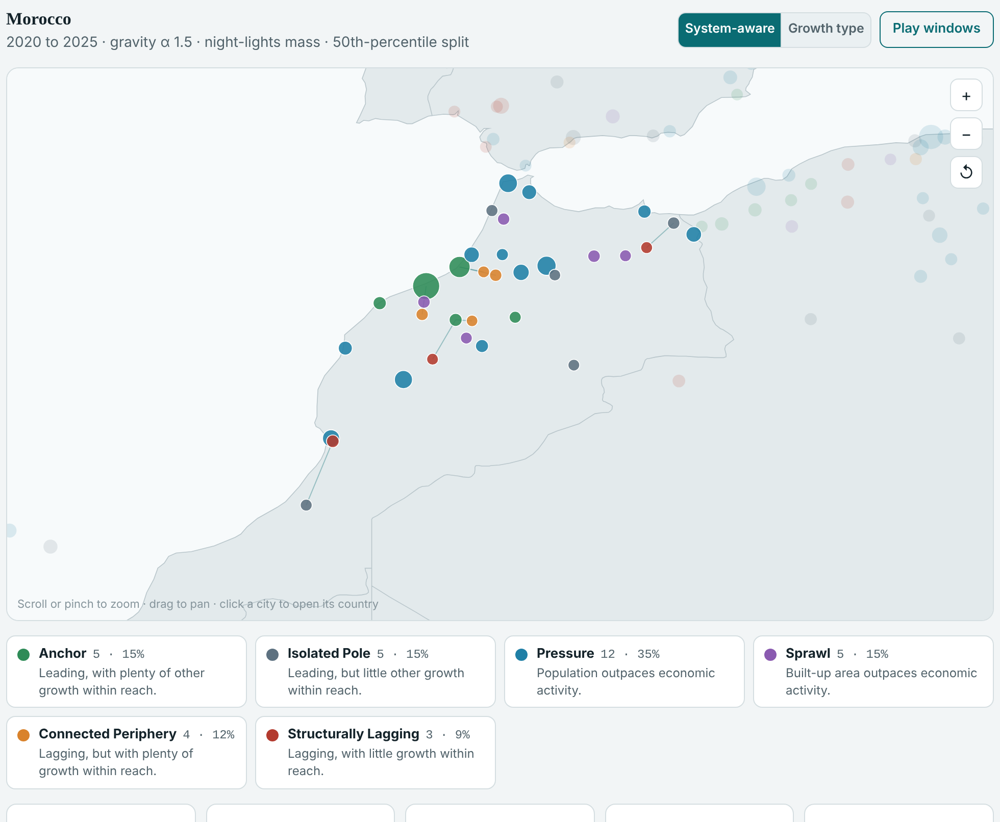
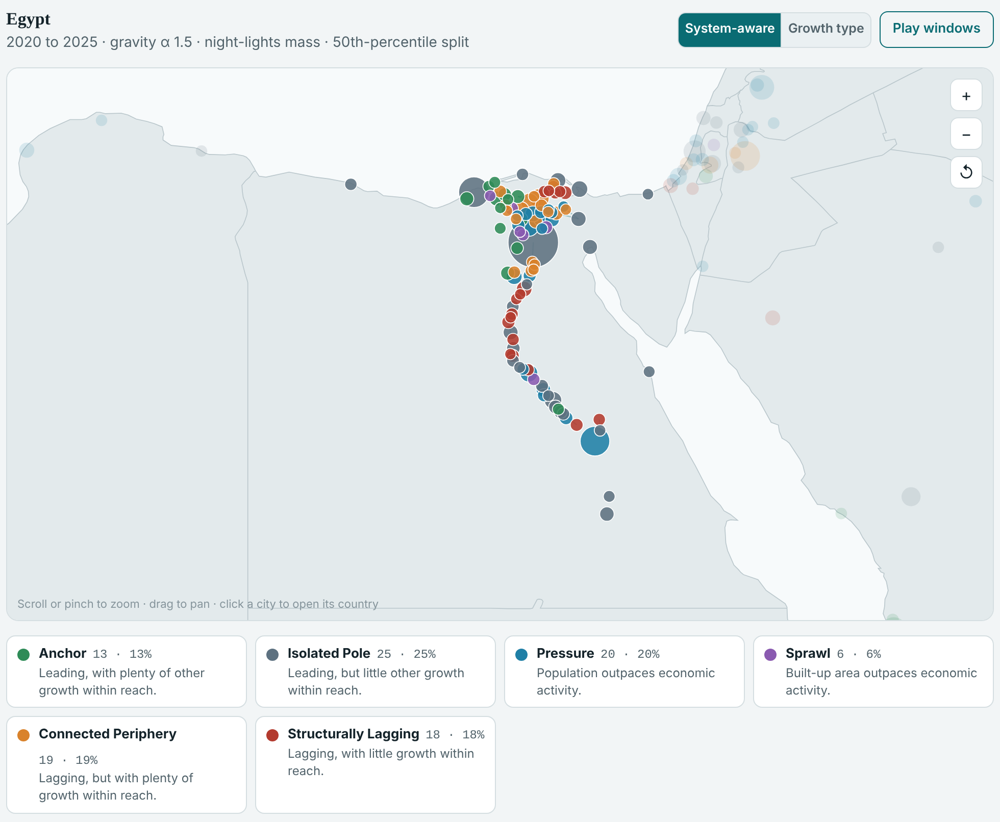
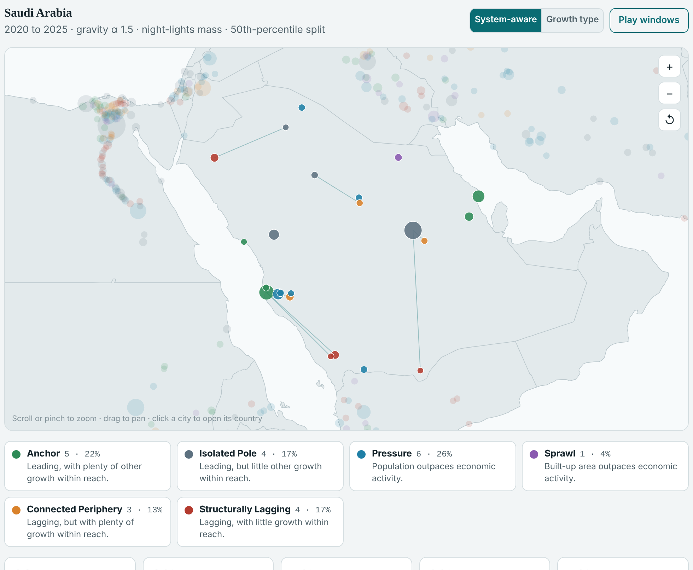

# A short guide to the Territorial Development Explorer

**[Open the explorer](https://hobark.github.io/td-dashboard-public/)**

## The idea

A city's prospects depend not only on its own size and growth, but on where it sits relative to the places where growth is happening in its country. A slowing town next to a booming metropolis is in a very different position from one far from any growing city.

Our usual tools miss this. Urban typologies label each city on its own attributes. Market access counts how much economic mass is nearby, but not whether that mass is growing: take two neighbouring cities of the same size, one growing 10% a year and the other shrinking 10% a year, and market access treats them the same.

The explorer asks two questions about every city, comparing it only with other cities in its own country:

1. **Is it growing or falling behind?** The explorer compares growth in night-time lights (a proxy for economic activity), population and built-up area.
2. **Is there growth nearby?** The explorer adds up the activity of nearby cities that are growing, giving closer cities more weight. Shrinking neighbours count for nothing.

## The four groups

| | Growth nearby | Little growth nearby |
|---|---|---|
| **Growing** (economy leads) | **Anchor**: one of several growth poles close together | **Isolated Pole**: growing largely on its own |
| **Falling behind** (below average on all three) | **Connected Periphery**: within reach of growth | **Structurally Lagging**: far from any growth |

The two lagging groups raise different questions. For a Connected Periphery, does nearby growth spill over, or does it pull people and firms away? For a Structurally Lagging city, linking it to growth poles is not an obvious option, so the constraints are more likely local.

On paper the two look alike. Worldwide, both have a median population of about 180,000. What separates them is position: typically 48 km versus 86 km from the nearest growing city.

Cities whose population or built-up area grows faster than their economy form two further groups, **Pressure** and **Sprawl**.

## Three countries

All figures use the paper's settings for 2020 to 2025. To follow along, pick the region *Middle East, North Africa, Afghanistan & Pakistan* in the left panel, then the country.

### Morocco: a clear picture

- Casablanca and Rabat are both Anchors: each is growing, within reach of the other.
- Agadir shows why only growth counts. Market access ranks it at the 65th percentile of Moroccan cities, but the nearest growing city is 164 km away, so its exposure to growth falls to the 12th.
- Lagging cities split cleanly by distance: Connected Peripheries are typically 57 km from a growing city and Structurally Lagging ones 103 km.
- The results hold up when you change the distance settings; at most 1 of the 34 cities changes group.

### Egypt: when everyone is slowing

- **Labels are relative.** Night lights fell in 79% of Egyptian cities. Cairo's lights grew only 0.2% a year, yet it leads. Tick *Leading requires lights to grow in absolute terms* and Leading cities drop from 38 to 21.
- **The capital can be isolated.** The big Delta cities around Cairo (Tanta, El Mahalla El Kubra, El Mansura) are shrinking, so they add nothing to Cairo's exposure. Seen from their side, they are Connected Peripheries.
- **Close is not the same as connected.** Most Structurally Lagging cities lie along the Nile in Upper Egypt, only about 26 km from a growing town. They lag because those towns are small.
- **Settings matter in a dense system.** Cities are about 12 km apart, so a 50 km cut-off changes 29 of 101 cities, including Cairo, which becomes an Anchor.

### Saudi Arabia: separate poles, long distances

- **Growth sits in separate clusters.** Jeddah anchors the Red Sea coast, and Dammam and Al Ahsa anchor the Eastern Province.
- **The capital is an Isolated Pole.** Riyadh's lights grew 4.1% a year, but the nearest other growing city is 300 km away.
- **Shrinking neighbours don't help each other.** Abha sits next to Khamis Mushayt, so market access ranks it at the 65th percentile. Both are shrinking, so its exposure to growth falls to the 26th.
- **The period matters more than distance.** Changing the distance settings moves at most 1 of 23 cities; switching to 2000 to 2025 moves 17, including Riyadh.

## Adjusting the settings

All settings are in the left panel. The map, counts and country profile update immediately, and a status line shows how many cities changed group compared with the paper.

| Setting | What it does | Paper |
|---|---|---|
| Growth window | The period growth is measured over. Use 2000 to 2025 for the long-run picture. | 2020 to 2025 |
| Distance decay | How fast a growing city's pull fades with distance: gravity (higher α is more local), exponential (falls to about a third at the bandwidth) or a hard cut-off. Each country profile suggests a bandwidth. | Gravity, α 1.5 |
| Mass | Night lights, or population where electrification is patchy or activity largely informal. | Night lights |
| High-exposure threshold | The percentile within the country above which a city counts as having growth nearby. | 50th |
| Minimum cities | Countries with fewer urban centres are not classified. | 5 |
| Absolute growth | Require a Leading city's lights to actually grow. | Off |

## Keep in mind

- Groups are relative to each country and describe one period, not a permanent state.
- Night lights are a proxy for activity, and 2020 to 2025 includes COVID-19.
- Distances are straight-line and stop at national borders.
- Exposure to growth is an opportunity, not an outcome: a nearby growing city can lift its neighbours or draw people and firms away from them.
- Some urban centres inherit quirks from the GHSL boundaries, such as Luxor's 6.3 million residents.

*Based on Park, H. "Measuring territorial development from publicly available data: a typology of cities and their exposure to growth" (under review).*
