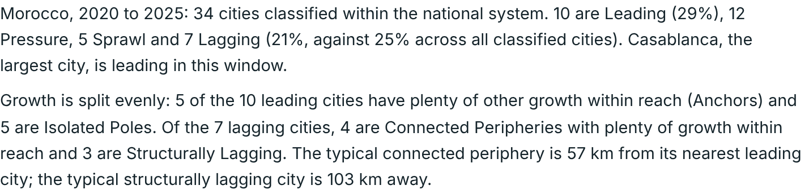
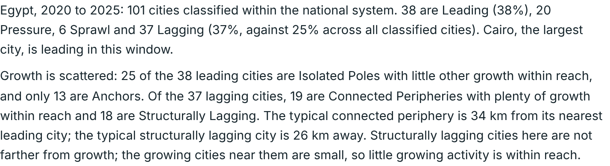

# How to read the Territorial Development Explorer

**Open the explorer: https://hobark.github.io/td-dashboard-public/**

This guide explains the idea behind the explorer, then walks through two examples, Morocco and Egypt, and ends with what each setting does. It accompanies the paper *Measuring territorial development from publicly available data: a typology of cities and their exposure to growth* (Park, under review).

## The idea in two questions

The explorer asks two questions about each of 5,423 urban centres. A city is always compared only with other cities in its own country.

### 1. What is driving the city's growth?

Each city's growth is measured in three ways: night-time lights (a proxy for economic activity), population and built-up area. Whichever grows fastest, relative to the country's other cities, sets the city's type.

| Type | What it means |
|---|---|
| **Leading** | The economy grows fastest |
| **Pressure** | Population grows faster than the economy: people arrive faster than activity expands |
| **Sprawl** | Built-up area grows faster than the economy: the city spreads out faster than it adds activity |
| **Lagging** | Below the national average on all three |

### 2. How much growth is within reach?

For each city, the explorer adds up the economic activity of the country's Leading cities, giving more weight to those that are closer. This is **exposure to growth** (Leading-Spillover Exposure in the paper).

The difference from standard market access is that **only growing cities count**. Two neighbours of a million people each, 50 km away, count the same under market access even if one grows 10% a year and the other shrinks 10% a year. Here only the growing one counts. Exposure is high when big growing cities are close; a small growing town next door adds little.

### Putting the two together

Exposure splits two of the types in half:

| | Plenty of growth within reach | Little growth within reach |
|---|---|---|
| **Leading** | Anchor | Isolated Pole |
| **Lagging** | Connected Periphery | Structurally Lagging |

Pressure and Sprawl keep their names.

On growth data alone, all Lagging cities look alike. For a Connected Periphery, the natural question is how to link it to the growth nearby. For a Structurally Lagging city that option is weak, and the binding constraints are more likely to be local.

## Example 1: Morocco, a clear picture

In the left panel choose the region *Middle East, North Africa, Afghanistan & Pakistan*, then *Morocco*. Figures use the paper's settings for 2020 to 2025.

- 34 cities are classified: 10 Leading, 12 Pressure, 5 Sprawl and 7 Lagging.
- **Casablanca** (lights +2.4% a year) and **Rabat** (+3.5% a year) are both Anchors: each is growing, and each has the other's growth within reach.
- **Agadir** shows why counting only growing cities matters. On standard market access it sits at the 65th percentile of Moroccan cities, because sizeable cities surround it. On exposure to growth it falls to the 12th percentile, because the nearest Leading city is 164 km away.
- Of the 7 Lagging cities, 4 are Connected Peripheries, typically 57 km from a Leading city. The other 3 are Structurally Lagging, typically 103 km away. In Morocco, distance does most of the work.
- The picture is robust. Reasonable changes to distance decay (gravity α from 1 to 3, or the suggested 70 km exponential decay) move at most 1 of the 34 cities.
- The time window matters far more. Over the long run (2000 to 2025), 21 of the 34 cities change category, including Casablanca, which moves from Anchor to Pressure.

## Example 2: Egypt, where the details matter

Now choose *Egypt*. It shows three things Morocco does not.

**Labels are relative.** 79% of Egyptian cities saw their night lights fall between 2020 and 2025, by a median of 2.6% a year. Cairo's lights grew by only 0.2% a year, yet it is Leading because it did better than almost every other Egyptian city. Tick *Leading requires lights to grow in absolute terms* and the number of Leading cities falls from 38 to 21.

**The largest city can be an Isolated Pole.** Cairo's exposure to growth is only at the 27th percentile. The large Delta cities around it, such as Tanta, El Mahalla El Kubra and El Mansura, are Lagging, with lights falling 4% to 5.5% a year, so they add nothing to Cairo's exposure. Seen from their side, they are Connected Peripheries: lagging, but with Cairo and other growing cities within reach.

**Close is not the same as connected.** Twelve of Egypt's 18 Structurally Lagging cities are in Upper Egypt, along the Nile Valley. They are typically only 26 km from a Leading city, which is closer than the Connected Peripheries (34 km). They are Structurally Lagging because the growing towns near them are small, so little growing activity is within reach.

**Settings matter more in dense systems.** Egyptian cities are typically 12 km apart, compared with 41 km in Morocco. A steeper gravity decay (α 2.5) changes the category of 16 of the 101 cities. A 50 km cut-off changes 29, and Cairo becomes an Anchor. The exponential decay suggested in the country profile (25 km) changes 8. For countries like Egypt, check results under more than one setting.

## What the settings do

All settings are in the left panel. Every map, count and profile recomputes in the browser when you change one. A status box reports how many cities change category compared with the paper's settings, and *Reset to paper settings* restores them.

| Setting | What it does | Paper setting |
|---|---|---|
| Growth window | The period over which growth is measured. Five-year windows show recent shifts; 2000 to 2025 shows the structural pattern. *Play windows* steps through the five-year windows. | 2020 to 2025 |
| Distance decay: gravity | Influence falls with distance raised to the power α. A higher α makes exposure more local. | α = 1.5 |
| Distance decay: exponential | Influence falls to about a third at the bandwidth you choose. Useful for dense or very large countries; each country profile suggests a value. | |
| Distance decay: cut-off | Only growing cities within the radius count, all equally. Read it as a commuting or market radius. | |
| Mass of leading cities | What each Leading city contributes. Use population where electrification is incomplete or much activity is informal, since lights understate activity there. | Night lights |
| High-exposure threshold | The within-country exposure percentile above which a city counts as having plenty of growth within reach. | 50th |
| Minimum cities per country | Countries with fewer urban centres are left unclassified. | 5 |
| Leading requires absolute growth | Requires a Leading city's lights to actually grow, not just fall less than the national average. | Off |

## Getting around

- Choose a country in the left panel or click any city on the map. The map zooms in, and a written profile and a sortable city table open below it.
- Hover over a city for its yearly growth rates, exposure percentile and distance to the nearest Leading city.
- Switch between the system-aware view and growth types above the map. Click a legend entry to hide or show a category.
- In a country view, thin lines link each Lagging city to its nearest Leading city.

## Keep in mind

- Categories describe growth over the chosen window and are relative to each country. Compare countries by their mix of categories, not by individual labels.
- Night lights are a proxy for economic activity. The 2020 to 2025 window includes COVID-19.
- Distances are straight-line between city centres and stay within national borders.
- Exposure measures opportunity, not impact. A nearby growing city can lift its neighbours or draw people and firms away from them.
- Some urban centres inherit quirks of the GHSL boundaries. For example, the Luxor urban centre in Egypt shows 6.3 million people and very fast population growth, which reflects how GHSL delineates it.
